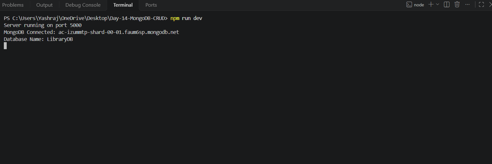
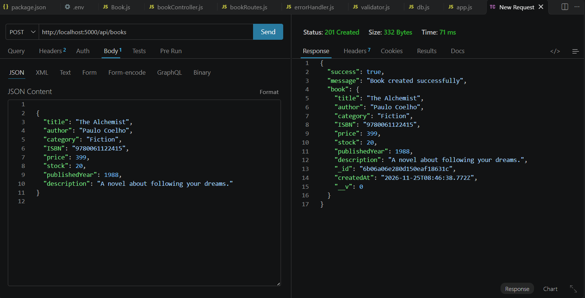
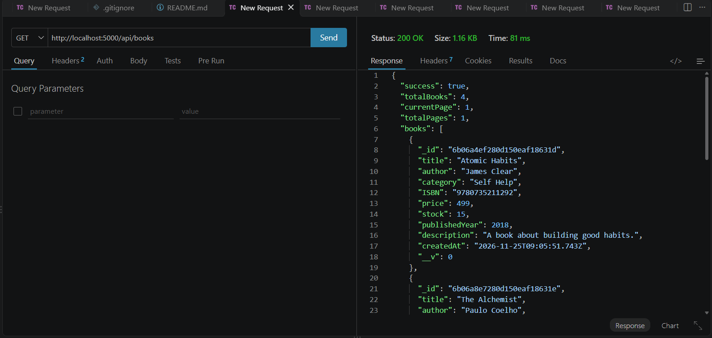
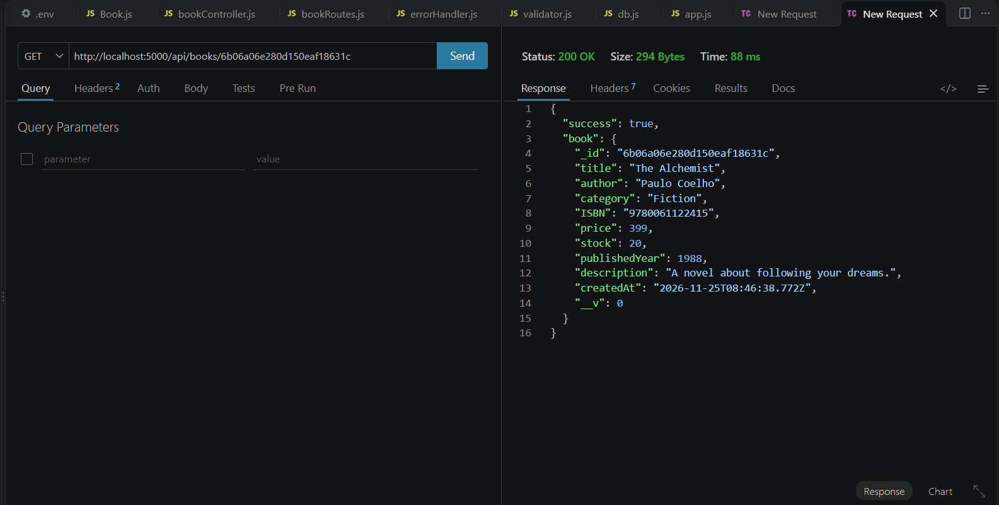
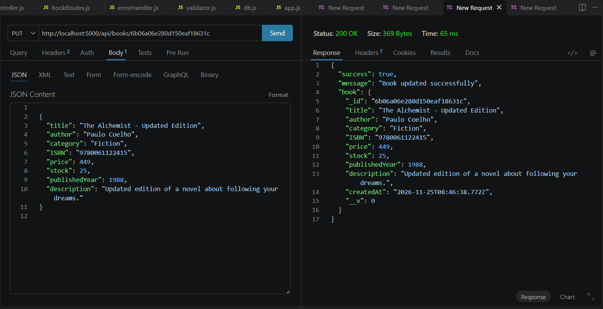
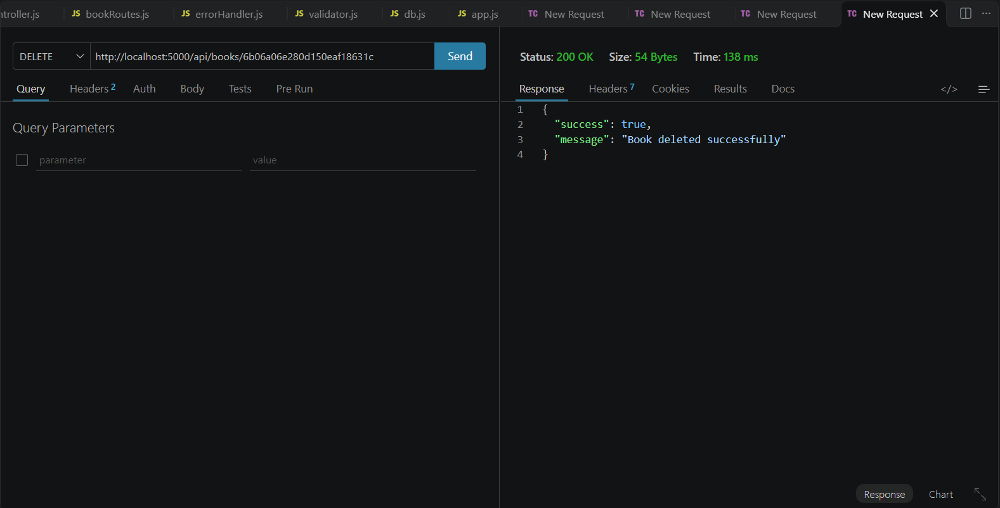

# Library Management API

A RESTful Library Management API built using Node.js, Express.js, MongoDB and Mongoose. This project performs CRUD operations on books with search, filtering, sorting and pagination.

## Technologies Used

- Node.js
- Express.js
- MongoDB Atlas
- Mongoose
- dotenv
- express-validator
- Thunder Client

## Project Structure

## Project Structure

Day-14-MongoDB-CRUD/
│
├── config/
│   └── db.js
│
├── controllers/
│   └── bookController.js
│
├── middleware/
│   ├── errorHandler.js
│   └── validator.js
│
├── models/
│   └── Book.js
│
├── routes/
│   └── bookRoutes.js
│
├── screenshots/
│
├── node_modules/
│
├── .env
├── .gitignore
├── app.js
├── package.json
├── package-lock.json
└── README.md

## Book Schema

| Field | Data Type | Description |
|---|---|---|
| title | String | Book title (required) |
| author | String | Author name (required) |
| category | String | Book category (required) |
| ISBN | String | Unique ISBN (required) |
| price | Number | Book price (minimum 0) |
| stock | Number | Available stock (minimum 0) |
| publishedYear | Number | Publication year |
| description | String | Optional description |
| createdAt | Date | Automatically generated date |

## API Endpoints

| Method | Endpoint | Description |
|---|---|---|
| GET | /api/books | Get all books |
| GET | /api/books/:id | Get book by ID |
| POST | /api/books | Create a new book |
| PUT | /api/books/:id | Update a book |
| DELETE | /api/books/:id | Delete a book |

## Query Features

- Search books by title
- Filter books by category
- Sort by price
- Sort by published year
- Pagination using page and limit

### Example Queries

```text
GET /api/books?search=Atomic

GET /api/books?category=Fiction

GET /api/books?sortBy=price&order=asc

GET /api/books?sortBy=publishedYear&order=desc

GET /api/books?page=1&limit=2
```

## Environment Setup

1. Clone the repository.
2. Install dependencies:

```bash
npm install
```

3. Create a `.env` file in the root directory:

```env
PORT=5000
MONGO_URI=your_mongodb_connection_string
```

4. Add your MongoDB Atlas connection string in the `.env` file.

5. Start the development server:

```bash
npm run dev
```

## Testing

All API endpoints were tested using Thunder Client.

Testing includes:

- MongoDB database connection
- Create Book
- Read All Books
- Read Book by ID
- Update Book
- Delete Book
- Search by Title
- Filter by Category
- Sorting by Price
- Sorting by Published Year
- Pagination


## API Testing Screenshots

All API endpoints were tested using Thunder Client.

### Database Connection


### Create Book


### Read All Books


### Read Book by ID


### Update Book


### Delete Book


## Author

Developed as part of the Apex Lark Full Stack Development Internship Program.
